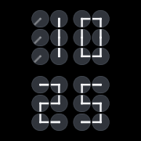
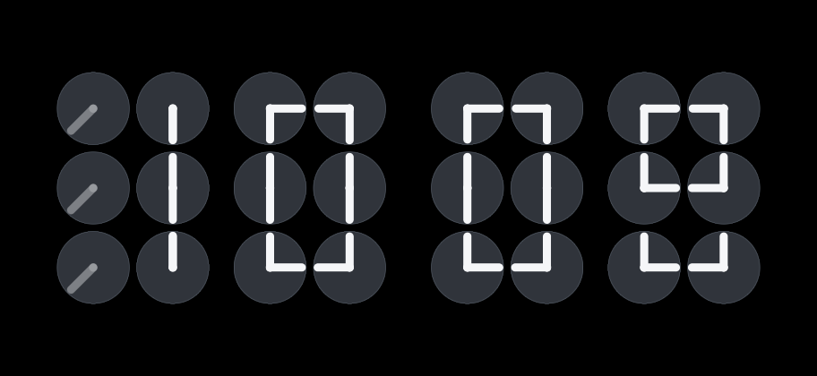
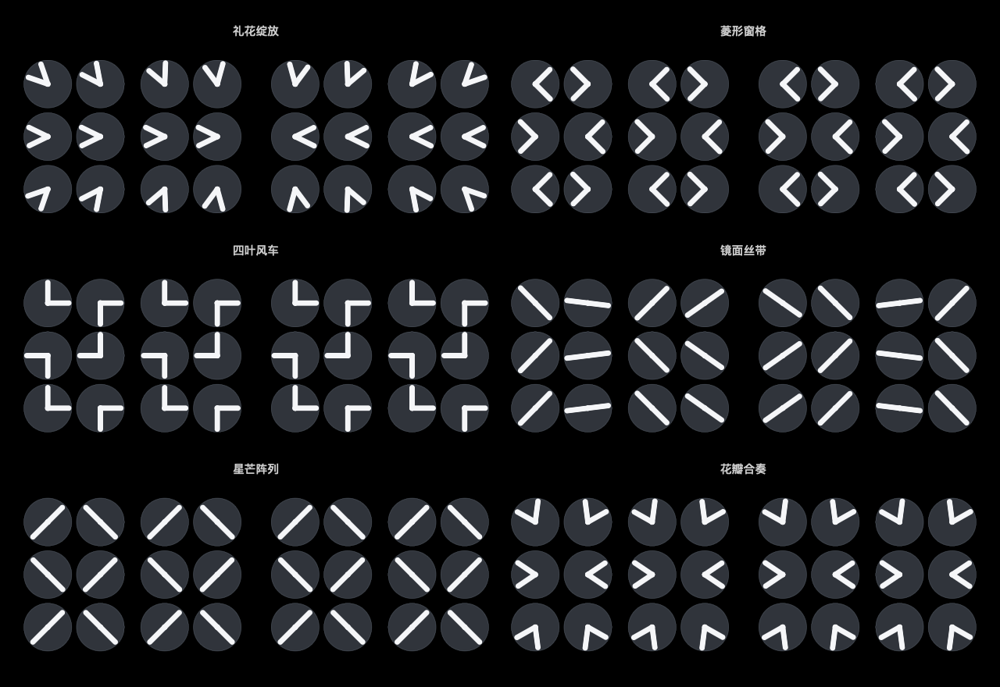
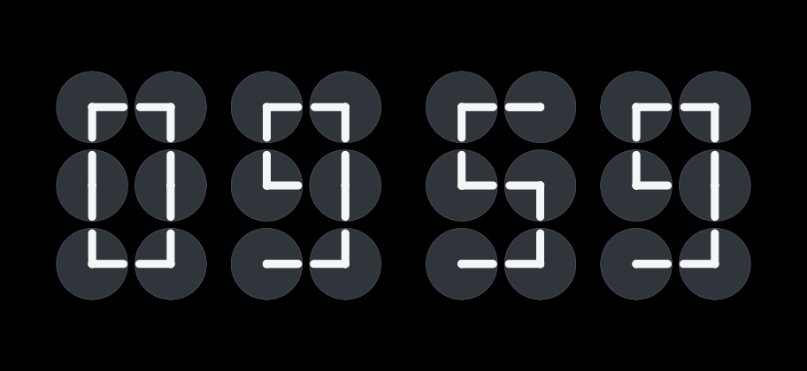

# ClockFlow

一个可放在充电支架上使用的原生 iOS 动态时钟。24 个钟面、48 根指针，在每分钟开始时旋转，最终组成当前时间。

## 个人研究与非商业说明

**这是一个出于个人兴趣、觉得好玩而自己动手实现的研究与学习项目。** 看到多个小钟面的指针一起组成时间的效果后，想在自己的 iPhone 上体验，也借此学习 SwiftUI 绘制、指针动画和时间调度，因此做了 ClockFlow。

- **项目定位**：个人研究、自用体验与非商业实验；公开仓库用于记录、交流实现过程，不用于销售或商业推广，不是正式商业产品。
- **灵感与参考**：动态时钟的视觉概念参考 [Humans since 1982 · ClockClock 24](https://www.humanssince1982.com/collections/collectibles)，六钟面数字构形对照了 [Manuel Wieser 的公开示例](https://codepen.io/Lorti/pen/XpQewQ)。感谢原作者的创作；相关来源也在文末保留。
- **独立实现、非官方项目**：本项目的 SwiftUI 绘制、编舞、调度和界面代码自行编写，仓库中的图标与绘制预览由本项目代码生成。不声称重现原作的全部官方动画，也不应被视为官方应用或官方授权版本；与原作者、品牌及工作室没有合作、赞助或背书关系。
- **尊重第三方权利**：相关名称、品牌标识及受保护作品的权利归各自权利人所有。本项目不主张拥有这些第三方权利，仓库公开也不授予任何第三方作品或品牌的使用许可。
- **使用边界与沟通**：个人研究、非商业用途和注明来源，并不自动意味着获得授权或免除侵权责任；本说明不能保证具体使用方式不侵权。如计划公开发行、上架、商业使用或引入第三方素材，请先核实所需授权与适用法律。如权利人认为仓库中的具体内容涉及其权利，欢迎通过 [GitHub Issues](https://github.com/XKing-2099/ClockFlow/issues) 说明依据和内容位置，我会及时核实并视情况调整或移除。

这是第一阶段的应用内全屏版本。应用保持在前台时可以阻止自动锁屏并降低亮度；手动锁屏后不会继续显示全屏动画。系统 StandBy、锁屏小组件和真正常显属于后续阶段。

## 名称与图标

应用显示名称为 **ClockFlow**：Clock 表示时钟，Flow 呼应指针在不同时间之间流动的编舞。桌面名称、应用标题及设置中的名称已统一更新。

图标用应用实际的 24 个钟面组成 **10:25**，上排为“10”、下排为“25”。沿用纯黑背景、炭灰钟面和柔白粗指针，不添加文字或装饰。1024 × 1024 图标由共享 Canvas 生成，没有透明通道，也不预先裁切圆角；小尺寸预览如下。



为保留现有安装身份和本机设置，工程文件和 scheme 没有改名；本机的签名团队及 Bundle Identifier 保存在不上传的 `Configuration/Signing.local.xcconfig` 中。继续打开 `Handscape.xcodeproj`、运行 `Handscape` scheme，安装到 iPhone 后显示的名称是 ClockFlow。

## 界面预览



## 已实现

- 纯黑背景，“石墨”配色：清晰的炭灰表盘、克制的灰色细边、加粗柔白指针；另保留纯白、暖白、夜红。
- 横屏 8 × 3 钟面矩阵；竖屏上下排列小时与分钟。
- 八种原创分钟编舞：对向旋转、波浪、逐列流动、中心涟漪、扇面展开、交织丝带、钟摆合奏、风车旋涡；可自动轮换、随机或固定选择，基础时长 3–12 秒。
- 每逢 10、20、30、40、50 分播放图案彩蛋，真正静止展示 1.5 秒；整点优先播放礼花绽放，展示 2 秒。随后组成真实时间，展示时长额外计入。
- 六种原创彩蛋图案：礼花绽放、菱形窗格、四叶风车、镜面丝带、星芒阵列、花瓣合奏。支持随时预览十分钟／整点彩蛋。
- 沉浸模式仅将紧凑的整组时钟等比例放大，不重新分配钟面间距。使用真实安全区内允许的最大尺寸，摄像头一侧额外保留约 4 点缓冲；不再为了四边等宽而限制大小。
- 日期紧跟时钟下方独立排列，为日期、顶部标题和底部控制栏预留空间，避免非沉浸状态下重叠。
- 日期字号为 18 点，独立预留 26 点高度；设置中所有开关开启后统一为绿色，与指针配色独立。
- 对齐整分钟；后台返回、时区变化、系统时间调整后重新读取当前时间。
- 静止时使用静态 Canvas；编舞期间才启用约 30 FPS 的 TimelineView。
- 保持屏幕开启、沉浸亮度、显示表盘、日期、12/24 小时制及轻微位移。
- 设置自动保存在本机；不使用网络、账户、服务器、广告或第三方依赖。
- 切到后台、锁屏或界面消失时恢复之前的亮度和自动锁屏设置。
- 支持系统“减弱动态效果”、应用内减少动画设置与 VoiceOver 时间朗读。

## 在 iPhone 上体验

环境：macOS 上的 Xcode 16 或更高版本；iPhone / iPad 系统为 iOS / iPadOS 17 或更高版本。

1. 第一次使用 Xcode 时，先打开 Xcode，阅读并确认其许可证，完成首次启动组件安装。如果需要模拟器，在 Xcode 设置中安装对应的 iOS Simulator runtime。
2. 打开本目录的 `Handscape.xcodeproj`，选择 `Handscape` scheme。
3. 先选择一台 iPhone 模拟器，点击运行（⌘R）。不需要配置签名团队即可使用模拟器。
4. 如需真机，连接 iPhone，在 Xcode → Settings → Accounts 添加自己的 Apple Account。首次从仓库下载时，将 `Configuration/Signing.local.xcconfig.example` 复制为 `Configuration/Signing.local.xcconfig`，填入自己的 `DEVELOPMENT_TEAM` 和唯一 `PRODUCT_BUNDLE_IDENTIFIER`；该本地文件已被 Git 忽略。已有本地文件的用户不必重建。保持 Target → Signing & Capabilities 中 Automatically manage signing 开启；不要把自己的签名信息写回公共工程文件。
5. 根据 iPhone 和 Xcode 的提示完成设备信任及 Developer Mode，然后选中这台 iPhone，点击运行。项目没有设置任何他人的签名账户或证书。

完成安装后，打开应用，将手机横放在充电支架上。若设备开启了竖排方向锁定，先关闭它。

## 使用方式

启动时先播放一次编舞并显示控制界面。8 秒后控制界面自动隐去，默认将屏幕亮度设为 30%，仅留下时钟。

- **轻点钟面区域**：显示 / 隐藏控制界面。显示控制时会暂时提高亮度，便于操作。
- **长按钟面区域**：打开设置。
- **演示**：立即播放所选编舞，最终回到当前时间，无需等待下一分钟；自动轮换模式连续点按会切换编舞，随机模式每次抽选且不连续重复。
- **沉浸**：立即隐藏控制、等比例放大整组时钟并应用沉浸亮度，不拉大行列间距；为刘海和轻微位移保留边距。
- **设置**：更换颜色和编舞，修改亮度、动画时长、日期、小时制等。
- **设置 → 时间彩蛋 → 预览十分钟彩蛋／预览整点彩蛋**：立即播放对应彩蛋，不修改手机时间；重复预览十分钟彩蛋会轮换图案。

“石墨”配色的背景为 `#000000`、表盘为 `#30343B`、细边为 `#555D68`、指针为 `#F5F6F8`。指针线宽当前为钟面单元的 11%，比上一版的 9% 再加粗约 22%；端点相应略微缩短，避免粗圆帽超出表盘。所有表盘使用平面填色，不增加阴影、光晕或渐变。这一配色保持背景纯黑，但提高表盘亮度、扩大显示面积仍会增加发光量；具体功耗需在实际亮度下测量。

新安装默认启用石墨、自动轮换和时间彩蛋。更新安装会保留已有偏好，亮度默认值按下述规则迁移；新增的时间彩蛋默认开启。若之前固定选择了“对向旋转”，请在设置的“分钟切换”中改选“自动轮换”，并在“画面”中选择“石墨”、打开“显示表盘”。

沉浸亮度默认值从 14% 提高到 30%，调节范围从 4–40% 扩大到 4–80%。更新安装时，仅与旧默认值相同的 14% 自动迁移为 30%，其他手动设置保留；迁移后再次选择 14% 也会保存，不会反复抬高。显示控制界面时亮度不低于沉浸亮度，退出或锁屏仍恢复进入应用前的亮度。30% 是本应用的体验起点，不代表已与系统常显的实际亮度校准；请在真实摆放环境下微调。更高亮度会增加发光量、功耗与发热风险，建议连接充电器并按需调节。

沉浸和非沉浸模式使用同一套固定的钟面坐标、数字间距与圆形表盘，只改变整体缩放。沉浸时优先尽量放大，距系统摄像头安全区边缘额外保留 4 点，覆盖可选的横向 ±3 点、纵向 ±2 点微移。不会越过摄像头安全区，也不会把单侧的摄像头留白强制复制到另一侧。默认保持物理屏幕居中；空间不足时在安全区内调整中心，为日期避让，不强求四边等宽。竖屏矩阵比例与手机屏幕不同，因此仍保留自然的上下留白。显示日期时，日期排在时钟下方，和时钟及控制栏保持独立间隔。

分钟切换时整组表盘发生小幅移动是默认开启的“轻微位移”，不是布局抖动或指针编舞造成的缩放。位置在横向 ±3 点、纵向 ±2 点的小范围内每分钟改变一次，同一分钟内不持续漂移。可在设置 → 画面 → 轻微位移中关闭；关闭后钟面位置固定，指针编舞与随机模式照常运行。这个设计用于避免内容永远固定在同一像素位置，不能保证完全避免残影。

“自动轮换”按本机分钟序号依次选择编舞；“随机”在每次普通分钟切换或演示时，随机抽选一套完整编舞，排除上一次播放的普通编舞，避免连续重复。随机选择只发生在动画开始时，不会在每帧改变动作，也不会随机扰动每根指针。原来的默认值与用户已选设置保持不变，需在设置 → 分钟切换中选择“随机”。完整路径在动画开始时生成：当前姿态 → 一个或多个中间姿态 → 图案停留 → 当前时间。十分钟彩蛋在五个图案间轮换；整点替代十分钟彩蛋，不连续叠加两套动画，也不改变普通编舞的随机记录。启动、后台返回或系统时间调整不会补播错过的彩蛋。系统／应用减少动画设置启用时，直接显示当前时间。





亮度只在沉浸状态自动降低，打开设置时保持可读。正常切到后台或锁屏会恢复进入本次显示会话前的亮度。应用在前台时屏幕仍处于开启状态，功耗通常高于系统 Always-On，建议连接充电器体验。轻微位移不能保证完全避免 OLED 残影。

“沉浸”是本应用自己的前台显示状态，不是接入系统 StandBy 或 Always-On。开启“沉浸时降低亮度”后，通过 Apple 官方 [`UIScreen.brightness`](https://developer.apple.com/documentation/uikit/uiscreen/brightness) 自动调整屏幕亮度（默认 30%，设置范围 4–80%）；开启“保持屏幕开启”后，通过 [`UIApplication.isIdleTimerDisabled`](https://developer.apple.com/documentation/uikit/uiapplication/isidletimerdisabled) 暂停自动锁屏。界面同时隐藏控制和系统允许隐藏的覆盖元素。切后台、锁屏或离开界面时，应用主动恢复先前的亮度与自动锁屏状态；手动按侧边按钮仍会锁屏，锁屏后不会继续显示本版的全屏动画。

## 项目结构

```text
Handscape.xcodeproj        可直接打开的 Xcode 项目及共享 scheme
Handscape/
  App/                    SwiftUI 入口
  Core/                   纯 Foundation 的数字、布局和编舞计算
  Models/                 本地设置与整分钟调度
  Services/               屏幕亮度与自动锁屏会话
  Views/                  Canvas 时钟、全屏界面、设置页
  Assets.xcassets/        图标、启动背景、主题色
  PrivacyInfo.xcprivacy    本地偏好和动画计时的 API 使用说明
Tests/CoreChecks.swift    可直接运行的核心行为检查
UITests/                  交互、编舞设置及自动分钟切换检查
Tools/RenderAssets.swift  共享 Canvas 的图标及视觉预览生成器
Previews/                 实际 Canvas 的静态绘制预览，非 iPhone 截图
Configuration/            公共签名默认值、示例和不上传的个人签名配置
scripts/                  核心检查及预览生成命令
```

核心不依赖 UIKit / SwiftUI，便于第二阶段复用数字排列和静态渲染数据。编舞和图案均自行实现，不声称重现原作所有官方动画。

## 检查与构建

在项目目录执行：

```sh
bash scripts/check-core.sh
bash scripts/render-assets.sh
xcodebuild -project Handscape.xcodeproj -scheme Handscape \
  -configuration Debug -destination 'generic/platform=iOS Simulator' \
  -derivedDataPath .build/DerivedData CODE_SIGNING_ALLOWED=NO build
```

核心检查覆盖全天 1,440 分钟、12/24 小时转换、午夜、跨时区、夏令时、整点优先级、横竖屏沉浸布局、八种编舞及六种彩蛋的起点／终点／连续性／中途重新开始、1.5／2 秒精确停留，以及旧版设置迁移。随机模式另检查全部八种动作可被选中、不连续重复、动画过程中选择固定，以及随机设置的保存。新增检查覆盖加粗指针的圆帽不超出表盘、放大日期的预留高度、分钟微移的范围／稳定性／关闭行为，以及 14% 旧默认值一次性迁移、其他亮度保留、4–80% 边界和重新打开后的持久化。

完整 Xcode 构建和模拟器运行需要先完成 Xcode 的首次启动。屏幕亮度、后台恢复、长时间摆放和实际功耗需要在 iPhone 上验证，模拟器不能代表这些硬件行为。

在 Xcode 中按 ⌘U 运行 UI 检查，或使用一台已安装的 iPhone 模拟器：

```sh
xcodebuild -project Handscape.xcodeproj -scheme Handscape \
  -destination 'platform=iOS Simulator,name=iPhone 17' \
  -derivedDataPath .build/DerivedData -parallel-testing-enabled NO \
  CODE_SIGNING_ALLOWED=NO test
```

UI 检查使用单独的本地设置域，不会重置正常使用时保存的偏好。自动分钟切换检查最多会等待下一分钟。

### 本次验证记录

- iOS Simulator Debug 构建通过；真机平台 Release 构建通过（未签名、未安装到物理设备）。
- 核心行为检查通过，涵盖 8,697,194 条断言。
- 四项模拟器 UI 检查全部通过：设置与编舞选择、沉浸放大／退出与 12/24 小时切换、自动整分钟更新、十分钟／整点彩蛋预览。
- 新增随机模式后，随机选择／设置保留与原有固定编舞选择两项 UI 复测通过；模拟器构建及未签名真机平台构建通过。
- 上一轮紧凑布局修正后，沉浸等比例放大／退出及横竖屏日期避让三项 UI 复测通过。本轮改为最大安全区尺寸，核心检查覆盖摄像头边缘缓冲、不对称安全区、最大等比例缩放、固定间距比例与日期／控制栏避让。
- 本轮沉浸放大／退出、竖屏日期避让、横屏放大与日期避让三项 UI 场景分批复测通过，未签名真机平台构建通过。亮度实现使用 UIKit 官方接口，不属于系统 StandBy 或 Always-On。
- 指针进一步加粗、日期放大和绿色开关调整后，设置／编舞、微移开关保留及横竖屏日期避让四项 UI 场景分批通过，绿色开关与大号日期已检查截图。首次横屏测试在清理旋转时遇到模拟器 SpringBoard 崩溃；改为先终止测试应用再旋转后，两项布局复测通过。
- 已检查共享 Canvas 的横屏、竖屏、沉浸布局、六种图案及八种编舞预览；附带整点动画 GIF。应用图标为 1024 × 1024 无透明通道 PNG。
- ClockFlow 改名及 10:25 图标更新后，模拟器 Debug 和未签名真机平台 Release 构建均通过；安装包中的显示名称、图标引用及缩小后的图标预览已核对。签名团队、Bundle Identifier 和设置存储键保持不变。
- 沉浸亮度提高到 30%、调节范围放宽到 4–80% 后，亮度迁移与持久化核心检查通过，未签名真机平台 Release 构建通过。不含本机签名文件的仓库副本也通过模拟器 Debug 构建；本机的签名团队和安装 Bundle ID 已核对保持原值。
- 沉浸亮度 UI 复测通过：新安装显示 30%，实际拖动滑块可选到旧 40% 上限以上，进入／退出沉浸后设置仍保留。屏幕实际发光亮度不由模拟器代表。
- 硬件亮度恢复、实际横放体验、温度和长时间功耗仍需真机验证。

## 灵感与参考

动态时钟概念参考 [Humans since 1982 · ClockClock 24](https://www.humanssince1982.com/collections/collectibles)。六钟面的数字构形通过 [Manuel Wieser 的公开示例](https://codepen.io/Lorti/pen/XpQewQ)对照检查。本项目自行编写 SwiftUI 绘制、编舞、调度和界面，与原工作室无关联；目前用于个人学习体验。

屏幕会话行为依据 Apple 的 [保持屏幕开启](https://developer.apple.com/documentation/uikit/uiapplication/isidletimerdisabled)与[亮度接口](https://developer.apple.com/documentation/uikit/uiscreen/brightness)实现。

